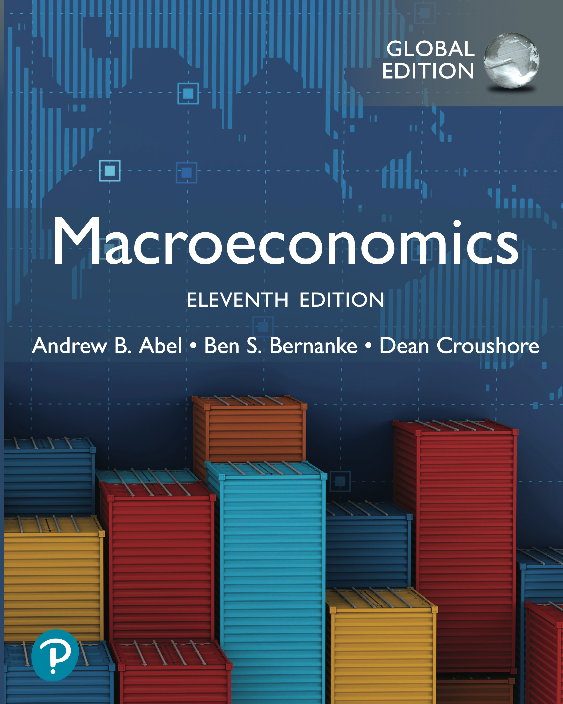
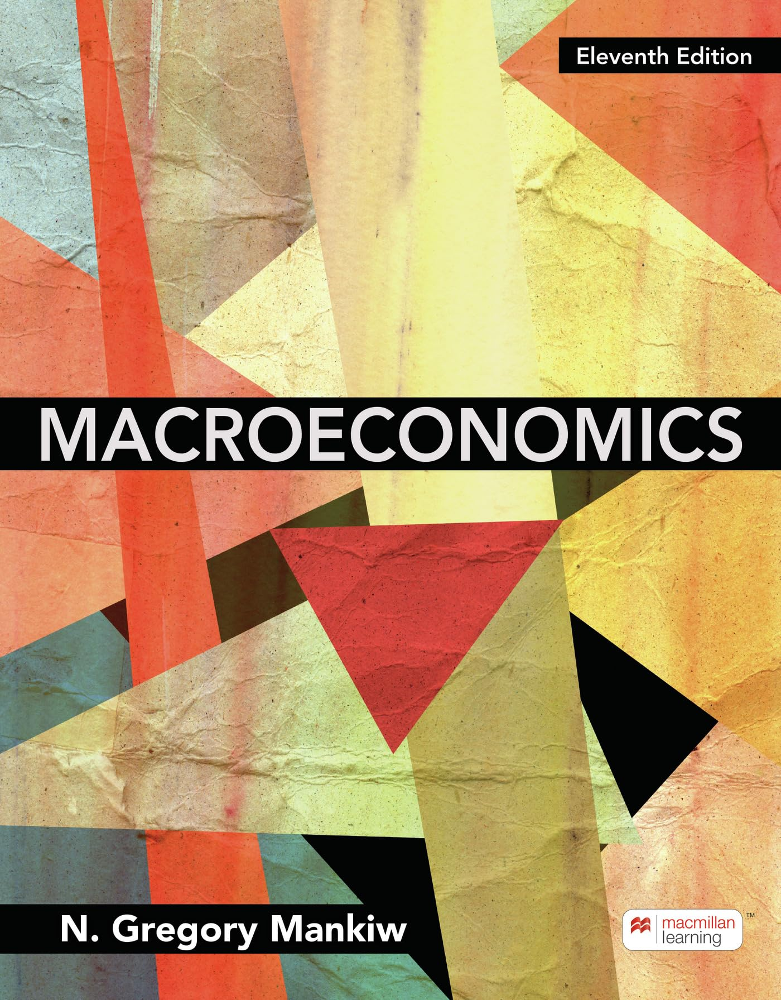

<nav class="mc-nav">
  <a href="#basic-information">Info</a>
  <a href="#teaching-philosophy">Philosophy</a>
  <a href="#objectives">Objectives</a>
  <a href="#course-outcomes">Outcomes</a>
  <a href="#schedule">Schedule</a>
  <a href="#grading">Grading</a>
  <a href="#textbooks">Textbooks</a>
  <a href="#course-policies">Policies</a>
  <a href="#materials">Materials</a>
</nav>

## Basic Information

| | |
| :-- | :-- |
| **Semester** | Monsoon/Fall 2026 |
| **Course Title** | Macroeconomics-I |
| **Course Code** | ECON 202 |
| **Program** | Under-Graduate |
| **Lecture–Tutorial–Practical** | 3-0-0 |
| **Section** | Section A & B |
| **Credit Hours** | 45 |
| **Internal Assessment** | 60% (Assignments, Problem Set, Mid-Term, Participation) |
| **End Term Examination** | 40% |
| **Prerequisites** | ECON 101 or ECON 102, ECON 122 |
| **Instructor** | Dr. Ravikiran Naik |
| **Contact** | [ravikiran.naik@flame.edu.in](mailto:ravikiran.naik@flame.edu.in) · +91-20-6790-6121 |
| **Office** | Room 108, Amrita Shergill Building |
| **Office Hours** | <a href="https://calendly.com/ravikiran-naik-flame/meet-dr-ravikiran">Book your slot</a> |
| **Classroom** | TGR001 |
| **Class Schedule** | **Sec A:** Tue 2:15–3:10 PM, Fri 2:15–4:10 PM · **Sec B:** Mon 2:15–4:10 PM, Wed 1:00–1:55 PM |

<small>*I reserve the right to make changes to this syllabus, including topics and due dates. Any changes will be announced as early as possible. Students are expected to read this outline in full; ignorance of its contents will not be accepted as justification after the first week of the semester.*</small>

This course is the first part of a two-course sequence introducing the fundamental concepts of
macroeconomics — the study of the economy as a whole. It begins with the measurement of aggregate
variables (GDP, CPI, unemployment), moves through the micro-founded theory of productivity,
consumption, investment, and money demand, and closes by integrating the goods, money, and labour
markets within the <strong>IS–LM</strong> and <strong>AS–AD</strong> frameworks to examine general equilibrium.

## Teaching Philosophy {#teaching-philosophy}

I teach macroeconomics as a connected set of models, not a list of topics: we build the goods, money, and labour markets and assemble them into one general-equilibrium framework. My emphasis is **genuine understanding over memorisation** — explaining the intuition, working through the mathematics, and applying models to real problems. Class time is active, and the course is deliberately demanding; I ask you to protect your attention, take your own notes, and use AI to support your learning, never to replace your thinking.

## Objectives

<ul class="pills">
<li>Introduce macroeconomic issues, schools of thought, and numerical measures of macroeconomic aggregates.</li>
<li>Analyse macroeconomic models of consumption, investment, employment, output, money, and inflation.</li>
<li>Understand both the short-run and long-run behaviour of the aggregate economy.</li>
<li>Model the determination of equilibrium output, integrating the goods, money, and labour markets.</li>
<li>Examine and critically analyse macroeconomic theories and macroeconomic policies.</li>
</ul>

## Course Outcomes

By the end of the course, students should be able to:

<ul class="pills">
<li>Define key macroeconomic indicators (GDP, inflation, CPI, unemployment rate, growth rate) and explain the different schools of macroeconomic thought.</li>
<li>Describe the theories of productivity, employment, and output relationships.</li>
<li>Apply theories of consumption, saving, and investment to economic scenarios.</li>
<li>Analyse and illustrate concepts related to assets, money, and prices.</li>
<li>Evaluate economic conditions using the IS-LM / AS-AD general framework.</li>
</ul>

## Topics &amp; Schedule {#schedule}

<table class="mc-sched">
  <thead>
    <tr><th>Week</th><th>Module &amp; Topics</th></tr>
  </thead>
  <tbody>
    <tr class="grp"><td>Week 1 (Aug 17)</td><td class="mod-cell" rowspan="3" style="--mc-c:#f7cfd8;">Module 1 · Introduction to Macroeconomics8 hours<ul><li>Introduction to macroeconomics</li><li>Measuring the value of economic activity — GDP</li><li>Measuring the cost of living — CPI</li><li>Measuring joblessness — the unemployment rate</li></ul></td></tr>
    <tr><td>Week 2 (Aug 24)</td></tr>
    <tr><td>Week 3 (Aug 31)</td></tr>
    <tr class="grp"><td>Week 4 (Sep 7)</td><td class="mod-cell" rowspan="3" style="--mc-c:#cde0c9;">Module 2 · Productivity, Employment and Output8 hours<ul><li>The production function and its properties</li><li>Labour demand, labour supply, and equilibrium</li><li>Unemployment — structural, cyclical, frictional</li><li>Okun's Law</li></ul></td></tr>
    <tr><td>Week 5 (Sep 14)</td></tr>
    <tr><td>Week 6 (Sep 21)</td></tr>
    <tr class="grp"><td>Week 7 (Sep 28)</td><td class="mod-cell" rowspan="3" style="--mc-c:#a9d8de;">Module 3 · Consumption, Saving and Investment8 hours<ul><li>Consumption, savings, and the factors affecting them</li><li>Investment — user cost, desired capital stock, desired investment</li><li>Goods-market equilibrium</li></ul></td></tr>
    <tr><td>Week 8 (Oct 5)</td></tr>
    <tr><td>Week 9 (Oct 12)</td></tr>
    <tr class="grp"><td>Week 10 (Oct 19)</td><td class="mod-cell" rowspan="3" style="--mc-c:#f5c9a6;">Module 4 · Asset Market, Money and Prices7 hours<ul><li>Money, functions of money, portfolio allocation, and demand for assets</li><li>Demand for money, velocity, and the Quantity Theory of Money</li><li>Asset-market equilibrium</li><li>Money growth and inflation</li></ul></td></tr>
    <tr><td>Week 11 (Oct 26)</td></tr>
    <tr><td>Week 12 (Nov 2)</td></tr>
    <tr class="grp"><td>Week 13 (Nov 9)</td><td class="mod-cell" rowspan="5" style="--mc-c:#d8cfe8;">Module 5 · IS–LM / AS–AD14 hours<ul><li>Labour-, goods-, and asset-market equilibrium</li><li>General equilibrium in IS-LM; price adjustments and attainment</li><li>Aggregate demand and aggregate supply; AS-AD equilibrium</li><li>Money neutrality</li></ul></td></tr>
    <tr><td>Week 14 (Nov 16)</td></tr>
    <tr><td>Week 15 (Nov 23)</td></tr>
    <tr><td>Week 16 (Nov 30)</td></tr>
    <tr><td>Week 17 (Dec 7)</td></tr>
  </tbody>
</table>

<em>Additional topics (not for assessment):</em> schools of thought · fiscal and monetary policies · business cycles.

### Important Dates <small>(tentative)</small> {#important-dates}

<ul class="mc-dates">
  <li>Quiz 1Week 7 · ~28 Sep 2026</li>
  <li>Midterm ExamSec A · 24 Oct · Sec B · 26 Oct 2026</li>
  <li>Problem Set dueWeek 10 · ~19 Oct 2026</li>
  <li>Quiz 2Week 13 · ~9 Nov 2026</li>
  <li>Review SessionWeek 17 · ~7 Dec 2026</li>
  <li>End Term Exam14–19 Dec 2026</li>
</ul>

<small>**Holidays (no class):** Ganesh Chaturthi Sep 14 (Sec B Mon); Gandhi Jayanti Oct 2 (Sec A Fri); Dussehra Oct 20 (Sec A Tue); Diwali break Nov 7–14 (both sections). Assessment deadlines may shift slightly around holidays.</small>

<table class="mc-sched" style="max-width:520px;margin-top:1.1rem;">
  <thead>
    <tr><th>Assessment</th><th>Section A</th><th>Section B</th></tr>
  </thead>
  <tbody>
    <tr><td>Group Assignment <small>(in class)</small></td><td>16 Oct 2026</td><td>19 Oct 2026</td></tr>
    <tr><td>Mid-Term Exam <small>(closed book)</small></td><td>24 Oct 2026</td><td>26 Oct 2026</td></tr>
  </tbody>
</table>

## Grading

This class is designed to be challenging, so do not expect an easy A. I reserve the right to adjust marks
upwards to standardise the median score; marks will never be adjusted down for this procedure.

  

    <strong>Component breakdown</strong>
    

      
<b>60/40</b><small>CIA · Final</small>

      <ul class="mc-legend">
        <li> End Term Exam 40%</li>
        <li> Mid Term Exam 20%</li>
        <li> Quiz (2) 20%</li>
        <li> Problem Set (Group) 10%</li>
        <li> Class Participation 10%</li>
      </ul>
    

  

  

    <strong>Grading scale</strong>
    

      
O

90+

      
A+

80+

      
A

70+

      
B+

60+

      
B

50+

      
C

40+

      
P

35+

    

  

## Textbooks

Required
<strong>Macroeconomics</strong> — Abel, A., Bernanke, B. &amp; Croushore, D., 11th ed., Pearson Education. Prepares students to analyse real economic data through a unified model that balances classical and Keynesian perspectives, showing how different macroeconomic models connect within the broader framework.

Supplemental
<strong>Macroeconomics</strong> — N. Gregory Mankiw, 11th ed., Macmillan Learning. A thorough, accessible overview that balances theoretical coverage with practical applications.

<em>Additional readings</em> (journal articles, book chapters, and other resources) will be provided at the start of the course and updated on <strong>MOODLE</strong>.

### Additional Readings {#additional-readings}

<a href="{{ '/teachings/macroeconomics-i/history-of-macroeconomics/' | relative_url }}"><strong>▸ A Short History of Macroeconomics</strong></a> — an optional illustrated background reading (schools of thought, from Keynes to IS–LM/AS–AD), with links to encyclopedia entries, blogs, and podcasts.

<a href="{{ '/blog/2026/what-did-they-divide-by/' | relative_url }}"><strong>▸ Before You Cheer the GDP Number, Ask What They Divided By</strong></a> — a short essay on real GDP, the deflator, and why the growth number is trickier than it looks (ties to Module 1).

<a href="{{ '/teachings/macroeconomics-i/concept-map-consumption-saving-investment/' | relative_url }}"><strong>▸ Concept Map — Consumption, Saving &amp; Investment</strong></a> — an interactive map of Module 3: how the real interest rate ties the saving decision, the user cost of capital, and goods-market equilibrium into one connected model (hover, click, or watch it build lecture-by-lecture).

<a href="{{ '/teachings/macroeconomics-i/islm-simulator/' | relative_url }}"><strong>▸ IS–LM Interactive Simulator</strong></a> — a browser-based tool for Module 5: drag the fiscal- and monetary-policy sliders and watch the IS and LM curves and the general equilibrium adjust in real time (based on the TU Berlin Chair of Macroeconomics toolkit).

<a href="{{ '/teachings/macroeconomics-i/islm-lab/' | relative_url }}"><strong>▸ IS–LM Lab — Three Markets, One Equilibrium</strong></a> — a step-by-step companion to the simulator: three linked panels (income–expenditure, money market, IS–LM), ghost lines for the old curves, and a disequilibrium walk-through — change a lever, then let the money market and goods market adjust one at a time. Rebuilt from the Seville teaching experiment (Pablo-Romero et al., 2012).

<a href="{{ '/teachings/macroeconomics-i/nobel-2026-hall-woodford/' | relative_url }}"><strong>▸ The 2026 Economics Nobel &mdash; Hall, Woodford, and where it sits in ECON 202</strong></a> &mdash; student notes on the Nobel awarded to Robert Hall and Michael Woodford: what they won for, and how it maps onto Modules 2&ndash;5 (the consumption function, unemployment, money, forward guidance, and IS&ndash;LM).

## Course Policies

### Attendance Policy

- Attendance is based solely on **physical presence** in class. There is no provision for make-up attendance through extra assignments or any other means.
- A **minimum of 75% attendance** is required to be eligible for the End Term Examination, as per FLAME University policy. The 25% leeway is specifically designed to cover all medical and personal contingencies over the semester.
- Approved exemptions (if any) are handled administratively at the backend — **the actual attendance record is never adjusted**.
- In case of a **prolonged medical emergency** (more than one week), inform me immediately — not after the semester is over and grades have been released.
- You are responsible for **catching up on all coursework** missed due to absence.
- If you are unable to attend a class, it would be helpful for me to know the reason, although it does not excuse the absence.

### Workload

Lecture slides are shared on MOODLE immediately after each module is completed. **Slides do not cover the complete course material** — they indicate what is broadly intended for the lecture. You are responsible for **all assigned content in the textbooks, even if not covered explicitly in class.** I will post lecture slides online, but simply reading slides is not a substitute for being in class.

### Assessments & Late Submission

- **Formative coursework** — non-graded quizzes and *Space Run* on [Socrative](https://b.socrative.com/student-v2/join), used to monitor learning and give ongoing feedback.
- **Quiz (2)** — two **in-class** quizzes worth **20%** combined; each covers material taught in class up to the previous week.
- **Problem Set (Group)** — comprehensive group assignment worth **10%**, covering analytical questions and mathematical problems involving algebra and basic calculus.
- **Midterm Exam** — covers the first 3–4 chapters; MCQs, short-answer questions, and problems with a fair mix of easy, medium and difficult questions; **closed book**.
- **End Term Examination** — comprehensive, emphasising the second half of the semester; same format as the midterm; also **closed book**.

**Deadlines are firm.** Late submissions of the individual assignment or problem set lose **10% of the component's marks per day** and are not accepted more than three days after the deadline, except where you have a documented and valid reason discussed with me in advance. There are no make-ups for the Midterm Examination except under the Office of the Dean or the Office of Examination's regulations for genuine, documented emergencies. The End Term Examination is governed solely by the Office of Examinations' regulations.

### Anti-Cheating Policy

A strong anti-cheating policy is in place. It assures all students that cheating is not occurring, and creates a deterrent effect. Violations of specified rules result in an **automatic deduction of 5 points**; more severe infractions incur a straight **0 for the component**. Claiming ignorance of these rules is not an acceptable excuse. The End Term Exam follows the regulations set by the Office of Examination.

### Academic Integrity & Referencing

**All work you submit must be your own.** Plagiarism (presenting others' words or ideas as your own), collusion (unauthorised collaboration — note that the group problem set is the *only* collaborative assessment), fabrication of results, and contract cheating are serious violations handled under FLAME University's academic-integrity regulations. Whenever you draw on a source — a textbook, article, dataset, or website — cite it clearly and consistently; if you are unsure what needs a citation, ask me before submitting.

### Use of Generative AI

This is a **no-AI class** for all graded work. Generative-AI tools may not be used to produce any part of your submitted individual assignment, the group problem set, or your exam answers; doing so is treated as an academic-integrity violation under the anti-cheating policy above.

That said, you are **encouraged to use AI tools — such as Claude, ChatGPT, Gemini, and NotebookLM — for your own learning**: to explain difficult concepts, test your understanding, or explore ideas outside of assessed work. They also make confident mistakes, so **verifying anything they tell you is your own responsibility** — treat AI output as a starting point to check against the textbook and lectures, never as an authoritative source.

### Class Participation

I encourage you to speak up in class — to ask questions or make comments. I often call on people, but do not be intimidated. **The goal is to think out loud, not to "test" you;** it is completely fine if you do not know an answer, and this will not affect your grade. **Engagement and active participation are critical** towards developing a deeper understanding of the material and will have a positive impact on your final grade. Be kind and respectful when addressing others.

### Communication & Email Policy

Before sending me a message, ask yourself two questions: *Can I find this myself — in the syllabus, on MOODLE, or by asking a classmate?* And: *if this were a workplace, would I take the initiative to figure this out before approaching my manager?* If the answer to either is yes, find it yourself first. This is not about protecting my inbox; it is about building the professional instincts you will need from day one of your first job.

**What belongs in an email:** substantive questions about course material you have genuinely thought through but cannot resolve alone, or personal concerns. These I welcome and will engage with seriously.

**What does not belong in an email:** deadline reminders, grade percentages, whether class is cancelled — anything answerable in thirty seconds by reading the syllabus or the MOODLE page. I will redirect these rather than answer them.

- Include **"ECON 202 / Section ?"** in the subject line.
- I reply within **24 hours** on working days; if you have not heard back, resend or remind me in class.
- For logistical questions that may help others, use the **MOODLE forum** — I monitor it and answer there so everyone benefits.
- A living FAQ page on MOODLE captures questions the syllabus did not answer; check it before emailing.

Substantive questions — the ones that push your thinking — are always welcome.

### Accessibility & Accommodations

I am committed to an inclusive classroom. Students with a disability or any condition that affects their participation or assessment are entitled to **reasonable accommodations**. Please contact the relevant FLAME University student-support office — and me, in confidence — as early in the semester as possible. All such requests are treated confidentially.

### Student Wellbeing & Support

**Your well-being matters more than any single grade.** If personal, health, or financial difficulties are affecting your studies, please reach out to me or to FLAME University's counselling and student-support services. Seeking help early makes a difference, and doing so will never count against you.

### Classroom Etiquette

- **Please keep phones silenced and out of sight during class.** Divided attention measurably lowers comprehension — for you and for those around you.
- Laptops and tablets are used only when a specific task calls for them (see Electronics Policy below).
- Arrive on time and engage with each other respectfully. Persistent disruption after a reminder may carry a small grade penalty.
- Standards of classroom conduct are **governed by the [FLAME University Handbook (pp. 28–29)](https://drive.google.com/file/d/1f7dzW6cfqjJFq1Yx-A9Q4LIbB-HZ7e29/view)**. A faculty member may ask a student to leave on grounds of indiscipline.

### Electronics Policy: No Laptops or Tablets During Class

Electronic devices, including laptops and tablets, are **prohibited during class sessions**.

**No Recording Devices:** Audio and video recording in the classroom, during examinations, and in office hours is **strictly prohibited** without explicit written permission. This covers all devices — phones, AI-enabled smart glasses, smartwatches, or any wearable capable of capturing audio or video. Violations are a breach of academic integrity and will be **referred to the University's Disciplinary Committee**.

**Exceptions:** Students with documented disabilities or legitimate academic needs may request device accommodations by scheduling office hours and providing professional documentation explaining why electronic devices are essential for their learning.

## Course Materials {#materials}

Slides go up on MOODLE right after each module; the same files (plus notes and problem sets) are mirrored here as they become available.

<table class="mc-sched mc-matrix">
  <thead>
    <tr><th>Module</th><th>Slides</th><th>Notes</th><th>Problems</th><th>Concept map</th></tr>
  </thead>
  <tbody>
    <tr>
      <td class="mod-cell" style="--mc-c:#f7cfd8;">M1GDP, CPI &amp; Unemployment</td>
      <td><a class="yes" href="/assets/pdf/teaching/macroeconomics-i/ch2-measurement-handout.pdf" title="Handout (PDF)">&#10003;</a></td>
      <td><a class="yes" href="{{ '/teachings/macroeconomics-i/notes-viewer/' | relative_url }}?f=/assets/pdf/teaching/macroeconomics-i/notes/m1-gdp-cpi-unemployment-notes.pdf&amp;t=M1%20%E2%80%94%20GDP,%20CPI%20%26%20Unemployment%20Notes" title="View notes">&#10003;</a></td>
      <td>&times;</td>
      <td>&times;</td>
    </tr>
    <tr>
      <td class="mod-cell" style="--mc-c:#cde0c9;">M2Productivity, Employment &amp; Output</td>
      <td><a class="yes" href="/assets/pdf/teaching/macroeconomics-i/ch3-productivity-handout.pdf" title="Handout (PDF)">&#10003;</a></td>
      <td><a class="yes" href="{{ '/teachings/macroeconomics-i/notes-viewer/' | relative_url }}?f=/assets/pdf/teaching/macroeconomics-i/notes/m2-productivity-output-employment-notes.pdf&amp;t=M2%20%E2%80%94%20Productivity,%20Employment%20%26%20Output%20Notes" title="View notes">&#10003;</a></td>
      <td>&times;</td>
      <td>&times;</td>
    </tr>
    <tr>
      <td class="mod-cell" style="--mc-c:#a9d8de;">M3Consumption, Saving &amp; Investment</td>
      <td><a class="yes" href="/assets/pdf/teaching/macroeconomics-i/ch4-consumption-saving-investment-handout.pdf" title="Handout (PDF)">&#10003;</a></td>
      <td><a class="yes" href="{{ '/teachings/macroeconomics-i/notes-viewer/' | relative_url }}?f=/assets/pdf/teaching/macroeconomics-i/notes/m3-consumption-saving-investment-notes.pdf&amp;t=M3%20%E2%80%94%20Consumption,%20Saving%20%26%20Investment%20Notes" title="View notes">&#10003;</a></td>
      <td><a class="yes" href="/assets/pdf/teaching/macroeconomics-i/problem-sets/ch4-consumption-saving-investment-key.pdf" title="Problems &amp; Solutions (PDF)">&#10003;</a></td>
      <td><a class="yes" href="{{ '/teachings/macroeconomics-i/concept-map-consumption-saving-investment/' | relative_url }}" title="Concept map">&#10003;</a></td>
    </tr>
    <tr>
      <td class="mod-cell" style="--mc-c:#f5c9a6;">M4Asset Market, Money &amp; Prices</td>
      <td><a class="yes" href="/assets/pdf/teaching/macroeconomics-i/ch7-asset-market-money-prices-handout.pdf" title="Handout (PDF)">&#10003;</a></td>
      <td><a class="yes" href="{{ '/teachings/macroeconomics-i/notes-viewer/' | relative_url }}?f=/assets/pdf/teaching/macroeconomics-i/notes/m4-asset-market-money-prices-notes.pdf&amp;t=M4%20%E2%80%94%20Asset%20Market,%20Money%20%26%20Prices%20Notes" title="View notes">&#10003;</a></td>
      <td>&times;</td>
      <td>&times;</td>
    </tr>
    <tr>
      <td class="mod-cell" style="--mc-c:#d8cfe8;">M5IS–LM / AS–AD General Equilibrium</td>
      <td>&times;</td>
      <td>&times;</td>
      <td>&times;</td>
      <td>&times;</td>
    </tr>
  </tbody>
</table>

<small>Slides mark what a lecture broadly covers; notes are not a substitute for attending and taking your own. Practice problems are ungraded self-study; the graded problem set is comprehensive (Modules 1–4) and involves algebra and basic calculus. The Concept map column links the interactive, lecture-by-lecture map for each module as it becomes available.</small>

<blockquote style="max-width:640px;margin:3rem auto 0;padding:0.25rem 0 0.25rem 1.25rem;border-left:3px solid var(--mc-blue);font-size:1.05rem;line-height:1.7;color:var(--mc-ink);">
  
Microeconomics is what economists know about. But macroeconomics is what they want to know about. That's what makes it so interesting.

  &mdash; Benjamin Friedman (quoted in Fisher, 1993)
</blockquote>

